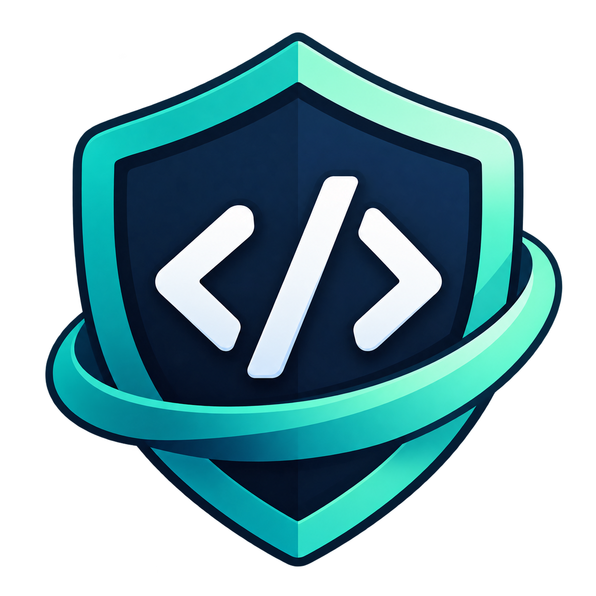

<div align="center">
  <a href="https://php2shell-guard.anwar-labs.workers.dev/">
    
  </a>

  <h1>PHP2Shell Guard</h1>

  <p><strong>Know where your PHP stands.</strong></p>
  <p>
    A free, open-source PHP security assessment tool for checking version evidence<br />
    against official fixes for <strong>CVE-2026-109618</strong> and <strong>CVE-2026-109619</strong>.
  </p>

  <p>
    <a href="https://php2shell-guard.anwar-labs.workers.dev/"><strong>Live application</strong></a>
    &nbsp;·&nbsp;
    <a href="https://github.com/Anwar0904/php2shell-guard">Source code</a>
    &nbsp;·&nbsp;
    <a href="https://github.com/Anwar0904/php2shell-guard/issues">Report an issue</a>
  </p>

  <p>
    <a href="https://github.com/Anwar0904/php2shell-guard/actions/workflows/ci.yml"></a>
    <a href="./LICENSE"></a>
    
    
  </p>
</div>

---

## Overview

**PHP2Shell Guard** helps developers and website owners understand what their PHP version *suggests* about exposure to two critical PHP vulnerabilities disclosed in October 2026.

Instead of providing an unqualified “safe” or “vulnerable” verdict, it explains the evidence, the official upstream fixed version, and what to verify next. You can use the version checker immediately, inspect response headers for approved websites, or run a small diagnostic on a PHP server you control.

**No account. No database. No paid API.**

> [!IMPORTANT]
> This is an **advisory and version-evidence tool**, not a penetration-testing service. A version string or HTTP header cannot confirm exploitation, installed vendor backports, or the security of an entire website.

## What you can do

| Tool | What it checks | Important boundary |
| :-- | :-- | :-- |
| **PHP Version Check** | Compare a manually entered PHP version with published upstream fixed releases for both CVEs. | Evaluates a version string, not a live server. |
| **Website Check** | Read public HTTP headers from specifically approved HTTPS hosts to find possible PHP version evidence. | **Only operator-allowlisted hostnames**; not an unrestricted URL scanner. |
| **Server Diagnostic** | Generate a minimal PHP CLI report and assess its JSON locally in your browser. | Inspects **CLI PHP**, which may differ from the web-serving runtime. |

### 1. PHP Version Check

Enter a version such as `8.4.26` to get an assessment for **both** supported CVEs, including its evidence and recommended next step. The comparison runs without requesting access to a website.

### 2. Website Check

For explicitly allowlisted, developer-controlled hosts, the Cloudflare Worker makes one read-only `HEAD` request to the HTTPS site root and examines returned header evidence. Requests to arbitrary hosts are rejected; redirects are not followed. Missing or ambiguous headers produce an inconclusive result.

### 3. Server Diagnostic

Download the open-source [PHP diagnostic](./tools/php-diagnostic.php), review it, and run it on a server you control. It records only the PHP version, SAPI, operating-system family, UTC timestamp, schema version, and CLI runtime context.

```bash
php tools/php-diagnostic.php > php-report.json
```

Import `php-report.json` in the **Server Diagnostic** tab. The file is parsed and assessed **in your browser**; its contents are not uploaded to the application. The diagnostic performs no network calls or shell commands and must **not** be exposed as a public PHP endpoint.

## Supported vulnerabilities

The current advisory dataset is sourced from the [PHP security announcement of October 21, 2026](https://www.php.net/archive/2026.php#2026-10-21-5).

| CVE | Description in the project | Official advisory |
| :-- | :-- | :-- |
| `CVE-2026-109618` | Remote code execution risk involving out-of-memory corruption | [PHP advisory](https://www.php.net/archive/2026.php#2026-10-21-5) |
| `CVE-2026-109619` | Remote code execution risk involving stale global state | [PHP advisory](https://www.php.net/archive/2026.php#2026-10-21-5) |

**First fixed upstream releases** recorded in the project:

| PHP branch | Fixed release |
| :-- | :-- |
| `8.2` | `8.2.35` |
| `8.3` | `8.3.36` |
| `8.4` | `8.4.27` |
| `8.5` | `8.5.12` |

A lower upstream version may still include a **distribution-maintained security backport**. Check your operating system or hosting provider's package advisory before concluding that an installation is vulnerable. Versions outside the documented branches are not automatically assumed to be safe.

### Understanding the results

| Assessment | Meaning |
| :-- | :-- |
| **Potentially affected** | The reported upstream version predates the published fix; installed patch status still needs verification. |
| **Upstream fixed release** | The version string meets the published upstream fixed-version threshold; actual deployment status is not verified. |
| **Legacy / vendor verification needed** | An older version requires separate vendor or package investigation. |
| **Unknown / inconclusive** | There is not enough reliable information for a version-based conclusion. |

The application reports its reasoning for each CVE rather than presenting a misleading all-clear indicator.

## Try it locally

**Requirements:** Node.js 22 (recommended) and npm. PHP CLI is optional unless you want to run the local diagnostic.

```bash
git clone https://github.com/Anwar0904/php2shell-guard.git
cd php2shell-guard
npm ci
npm run dev
```

Open the local address shown by Vite in your terminal.

To enable website checks during local development, create `.dev.vars` with **only exact HTTPS hostnames you own and have approved**:

```dotenv
SCAN_ALLOWED_HOSTS=staging.example.com
```

The allowlist is empty by default. Do not use wildcards or populate it with unrelated public websites. The backend enforces the restriction regardless of frontend input validation.

### Commands

| Command | Purpose |
| :-- | :-- |
| `npm run dev` | Start the local development server |
| `npm test` | Run automated tests with Vitest |
| `npm run build` | Run TypeScript checks and produce the production build |
| `npm run seo:check` | Validate generated SEO resources (run after building) |
| `npm run lint` | Run ESLint |
| `npm run preview` | Preview a production build locally |
| `npm run deploy` | Build and deploy using Cloudflare Wrangler |

For the PHP diagnostic, you can additionally run `php -l tools/php-diagnostic.php` before execution.

## Architecture

```text
React + Vite + TypeScript
│
├── PHP Version Check
│   └── Local assessment engine + advisory data
│
├── Website Check
│   └── Cloudflare Worker /api/scan
│       └── Exact-host allowlist → one HTTPS HEAD request
│
└── Server Diagnostic
    └── PHP CLI script → local JSON file → browser-only analysis
```

**Stack:** React, TypeScript, Vite, Tailwind CSS, Cloudflare Workers, and Vitest. There is **no application database**.

Key paths: [`src/assessment.ts`](./src/assessment.ts) (assessment engine), [`src/data/advisories.ts`](./src/data/advisories.ts) (advisory data), [`worker/scan.ts`](./worker/scan.ts) (restricted website checks), [`src/diagnostic.ts`](./src/diagnostic.ts) (report validation), and [`tools/php-diagnostic.php`](./tools/php-diagnostic.php) (read-only CLI script).

## Privacy and security boundaries

- **Version check:** assesses a provided version string without needing to inspect a server.
- **Website check:** uses a Cloudflare Worker for network access, with a default-empty exact-host allowlist, HTTPS-only validation, a single `HEAD` request, and redirects disabled.
- **Server diagnostic:** locally imported JSON is processed in the browser; there is no diagnostic-upload API or persistent scan history.
- **No active exploitation:** the project does not send vulnerability payloads, perform remote exploit confirmation, or scan arbitrary third-party sites.
- **No guarantee of safety:** PHP CLI, HTTP headers, and version strings do not independently prove which patches are installed in a live web-serving process.

Only assess systems you own or are explicitly authorized to test. For responsible disclosure of a problem **in PHP2Shell Guard itself**, see [SECURITY.md](./SECURITY.md).

## Deployment

The application runs as a React static frontend with a Cloudflare Worker API. The current public deployment is:

**[php2shell-guard.anwar-labs.workers.dev](https://php2shell-guard.anwar-labs.workers.dev/)**

For a maintainer-controlled deployment:

```bash
npm ci
npm test
npm run build
npm run seo:check
npm run lint
npx wrangler login
npm run deploy -- --keep-vars
```

Keep `SCAN_ALLOWED_HOSTS` unset in production unless you have specific developer-controlled targets to approve. Deployment does not require MongoDB, user accounts, or a paid API. Hosting remains subject to Cloudflare's plan limits.

The repository's [CI workflow](./.github/workflows/ci.yml) runs automated checks on pushes and pull requests; it does **not** deploy automatically.

## Roadmap

- [x] PHP advisory version assessment for both supported CVEs
- [x] Allowlisted HTTPS header inspection
- [x] Read-only CLI diagnostic with private browser-side JSON import
- [x] Responsive UI, automated tests, and Cloudflare deployment
- [x] Basic technical SEO, including metadata, sitemap, and robots directives
- [ ] More comprehensive, authenticated web-runtime and vendor-package evidence
- [ ] Broader URL assessment **only if** connection-level safety controls can be validated

Planned items are directions for further development, not available features or release promises.

## Contributing

Bug reports, documentation improvements, test cases, and careful security reviews are welcome. Please read [CONTRIBUTING.md](./CONTRIBUTING.md) and open an [issue](https://github.com/Anwar0904/php2shell-guard/issues) before proposing substantial changes.

## License and maintainer

Released under the [MIT License](./LICENSE). Maintained by [Anwar0904](https://github.com/Anwar0904).

<div align="center">
  <sub>Built for clearer PHP security decisions — with evidence, limitations, and actionable next steps.</sub>
</div>
